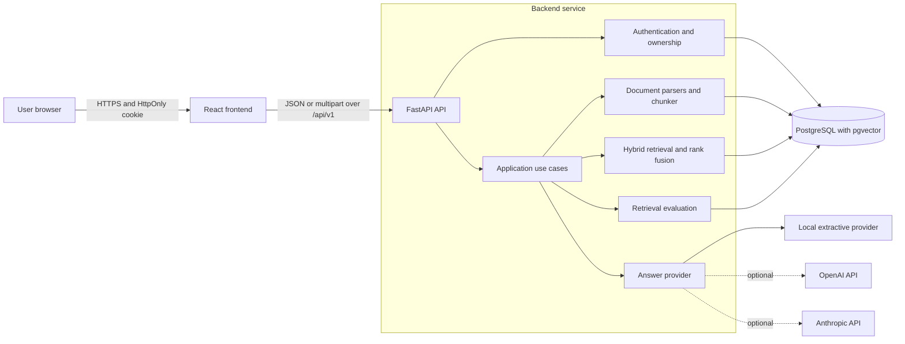
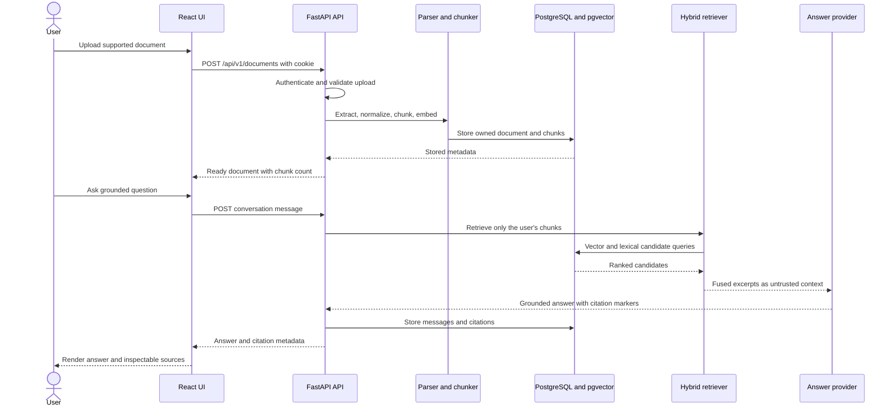
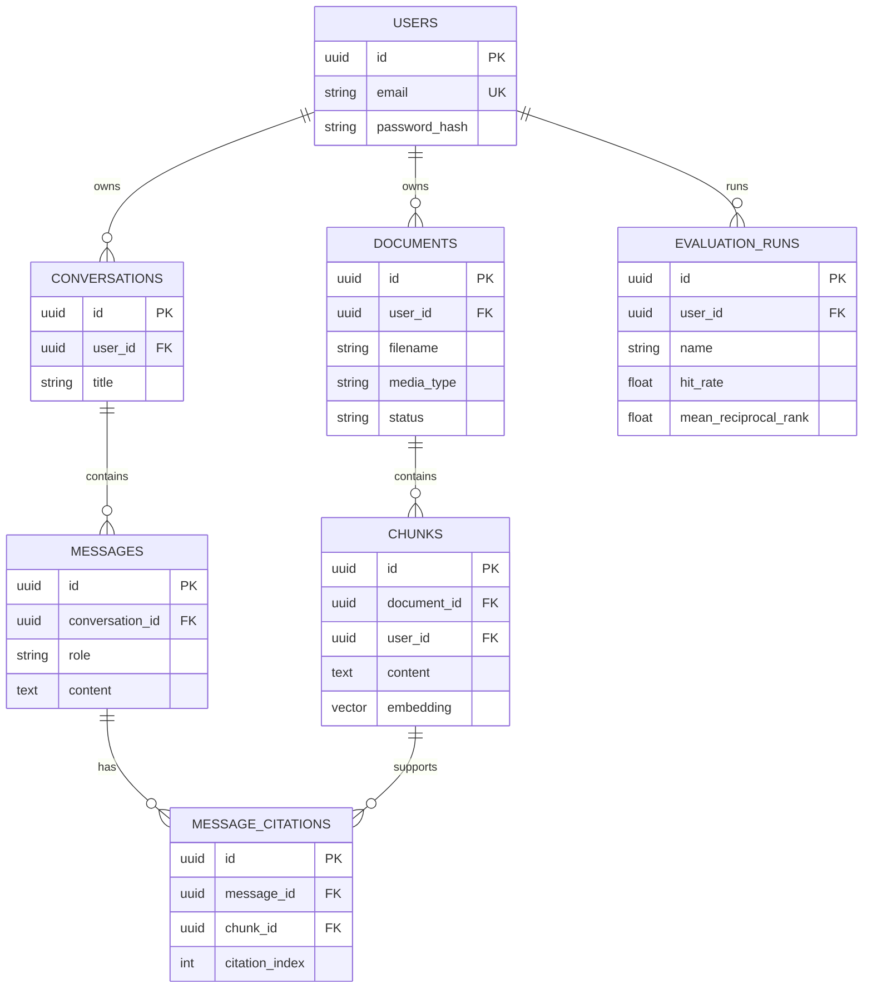
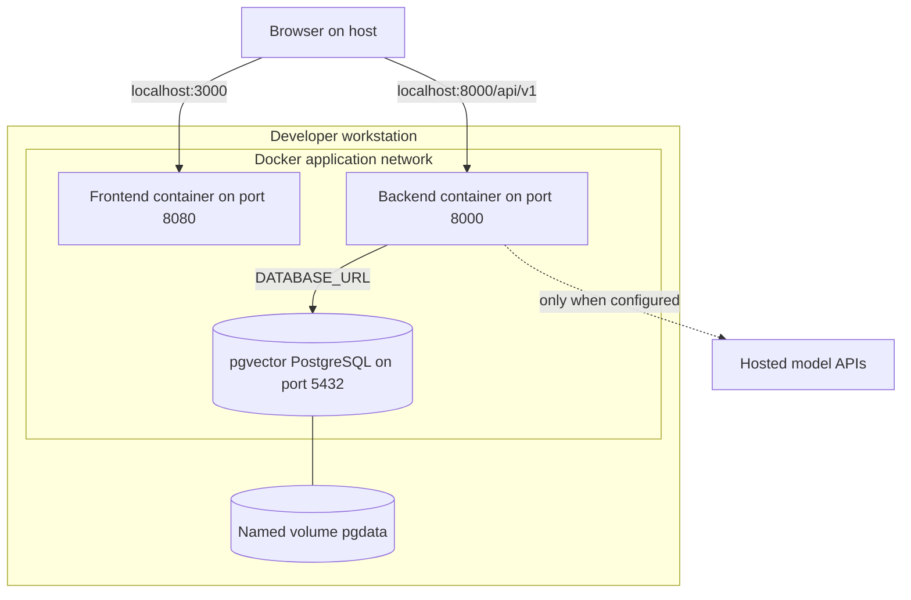

# Enterprise RAG Assistant

A pre-release, multi-user retrieval-augmented generation application for
uploading private documents, asking grounded questions, inspecting citations,
and measuring retrieval quality. The MVP is designed to run locally without a
paid AI credential by using deterministic embeddings and an extractive answer
provider.

> **Project status: MVP verified locally.** On 2026-11-09 the backend and
> frontend checks, both image builds, PostgreSQL migration, Compose health, and
> the authenticated upload/retrieval/citation flow passed locally. GitHub Actions
> and hosted model providers remain unverified.

## Current status

### Implemented and locally verified

- FastAPI registration, login, logout, and short-lived `HttpOnly` cookie
  authentication.
- Per-user document, conversation, retrieval, and evaluation isolation.
- TXT, Markdown, PDF, and DOCX parsing with bounded uploads and chunking.
- Deterministic offline embeddings and answer generation.
- PostgreSQL/pgvector cosine search, PostgreSQL full-text search, and reciprocal
  rank fusion.
- Source-grounded answers, persisted citations, conversation history, and
  retrieval evaluation.
- Optional OpenAI and Anthropic HTTP adapters with runtime-only keys.
- Responsive React/TypeScript workspace for authentication, document
  management, conversations, chat, and citation inspection.
- Alembic migration, non-root backend/frontend images, pgvector Compose
  topology, health checks, structured logs, and Prometheus metrics.
- CI, dependency automation, issue templates, pull-request template, threat
  model, architecture decisions, and deployment/testing documentation.

### Verified evidence from 2026-11-09

- Backend: Ruff lint and formatting passed; mypy passed; 22 tests passed with
  87% measured line/branch coverage.
- Frontend: TypeScript check passed; 9 Vitest tests passed; Vite production
  build produced a 294.23 kB JavaScript bundle (92.25 kB gzip).
- Containers: backend and frontend images built successfully.
- Integration: PostgreSQL 16 with pgvector migrated successfully; all three
  Compose services reached healthy state.
- End to end: registration, cookie authentication, text ingestion, hybrid
  retrieval, cited answer, history persistence, evaluation hit rate, Nginx API
  proxy, and second-user isolation passed through `scripts/smoke_test.py`.

### Planned outside the first vertical slice

- Organization administration and billing.
- Refresh-token rotation.
- Background job processing.
- OCR and streaming model responses.
- A supported cloud deployment architecture.

## Architecture

The diagrams show the intended MVP architecture. Solid components are part of
the repository contract; their runtime status is governed by the checks above.

### System architecture



### Upload and question sequence



### Data model



### Local deployment



For component boundaries and design trade-offs, see
[`docs/architecture.md`](docs/architecture.md).

## Quick start with Docker Compose

Prerequisites:

- Docker Engine or Docker Desktop with the Compose v2 plugin.
- Available host ports `3000` and `8000`, or alternative values in `.env`.

Create local configuration:

```sh
cp .env.example .env
```

On PowerShell:

```powershell
Copy-Item .env.example .env
```

Replace `POSTGRES_PASSWORD` and `RAG_JWT_SECRET` in `.env`. A URL-safe secret can
be generated without a third-party package:

```sh
python -c "import secrets; print(secrets.token_urlsafe(48))"
```

Validate and start the stack:

```sh
docker compose --env-file .env config --quiet
docker compose --env-file .env up --build
```

When all containers are healthy:

- Frontend: <http://localhost:3000>
- API liveness: <http://localhost:8000/api/v1/health/live>
- API readiness: <http://localhost:8000/api/v1/health/ready>
- Metrics: <http://localhost:8000/api/v1/metrics>

Stop containers without deleting document data:

```sh
docker compose down
```

Deleting the `pgdata` volume is destructive and intentionally not part of the
normal stop command. See [`docs/deployment.md`](docs/deployment.md) before
adapting this development topology for another environment.

## Development checks

Frontend commands are defined in `frontend/package.json` and require Node.js
20.19 or newer:

```sh
cd frontend
npm ci
npm run typecheck
npm test
npm run build
```

The backend locked development environment is:

```sh
cd backend
python -m pip install -r requirements-dev.lock
python -m ruff check .
python -m ruff format --check .
python -m mypy app
python -m pytest --cov=app --cov-report=term-missing
```

Run the deployed integration path:

```sh
python scripts/smoke_test.py
```

Set `RAG_SMOKE_API_URL=http://localhost:3000/api/v1` to exercise the Nginx
same-origin proxy as well as the API.

## API boundary

Application routes are under `/api/v1`. The specified groups are:

- `/auth` for registration, login, logout, and the current user;
- `/documents` for owned upload, listing, and deletion;
- `/conversations` for owned conversations, messages, answers, and citations;
- `/evaluations/retrieval` for hit-rate and mean reciprocal rank evaluation.

Operational endpoints are `/api/v1/health/live`, `/api/v1/health/ready`, and
`/api/v1/metrics`.
Request and response shapes are defined in
[`docs/implementation-spec.md`](docs/implementation-spec.md).

## Security model

The design uses short-lived signed cookies, explicit credentialed CORS,
ownership-scoped queries, bounded document parsing, and local providers by
default. Uploaded documents and retrieved excerpts are untrusted input, not
instructions. Hosted providers are opt-in and must receive keys only through
environment configuration.

This is a design baseline, not a security certification. Read
[`SECURITY.md`](SECURITY.md) before reporting a vulnerability and
[`docs/security.md`](docs/security.md) for the threat model and required
controls.

## Remaining unverified gates

- The GitHub Actions workflow has not run because this repository has not yet
  been published.
- The workflow's secret scan and pull-request dependency review therefore have
  no remote result.
- OpenAI and Anthropic live calls were not attempted because no provider
  credentials were supplied; their HTTP adapter behavior is covered with a
  deterministic mock.
- No cloud or Kubernetes deployment is claimed.
- Browser automation and a real assistive-technology review remain future
  quality work.

## Documentation

- [Implementation specification](docs/implementation-spec.md)
- [Architecture](docs/architecture.md)
- [Security threat model](docs/security.md)
- [Testing strategy](docs/testing.md)
- [Deployment guide](docs/deployment.md)
- [ADR 0001: System architecture](docs/adr/0001-system-architecture.md)
- [ADR 0002: pgvector hybrid retrieval](docs/adr/0002-pgvector-hybrid-retrieval.md)
- [Contributing](CONTRIBUTING.md)

## License

Licensed under the [MIT License](LICENSE).
